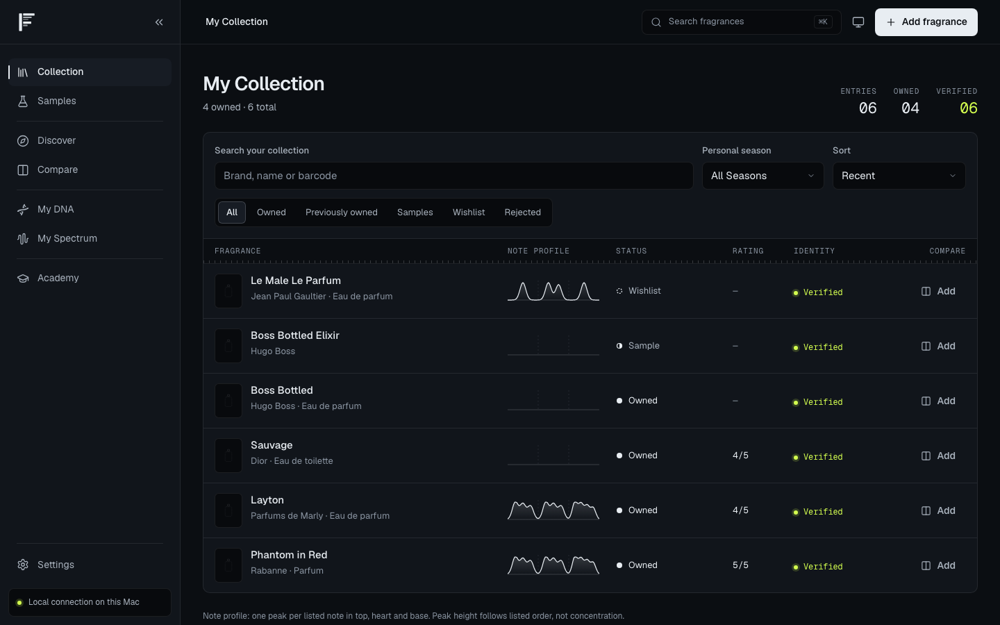
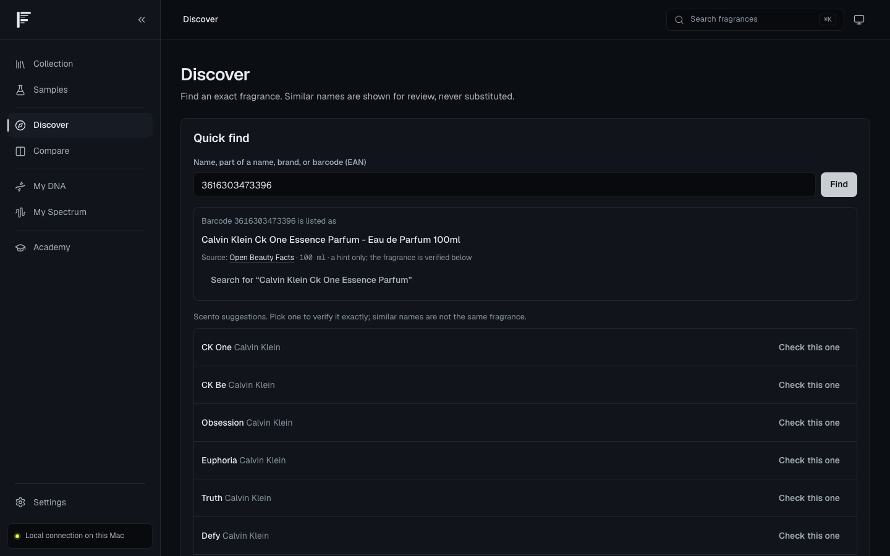
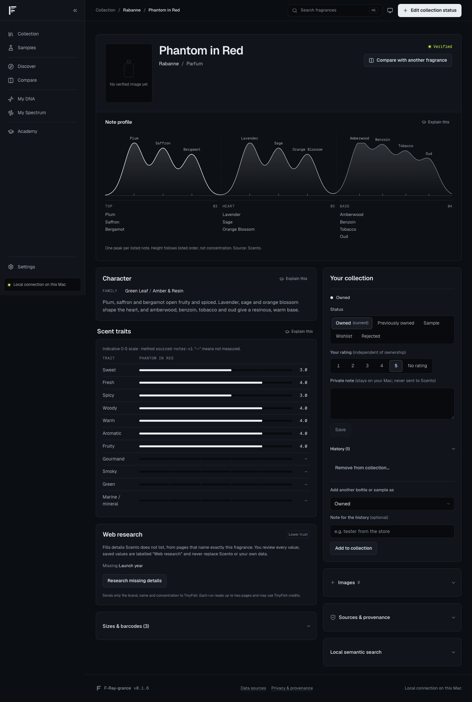
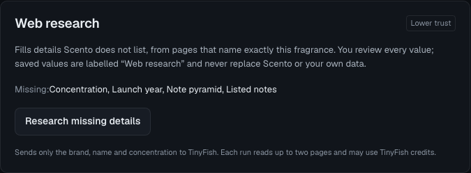
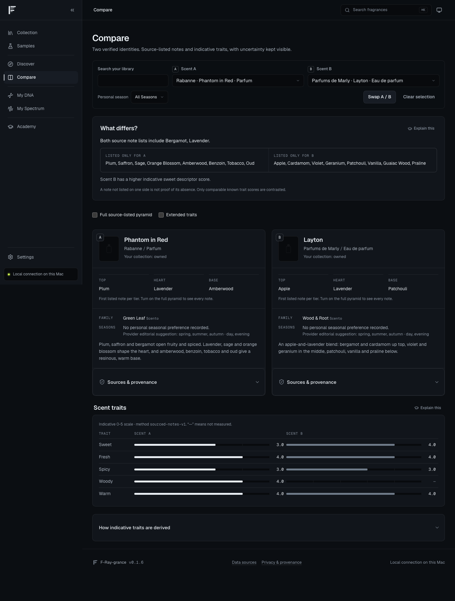
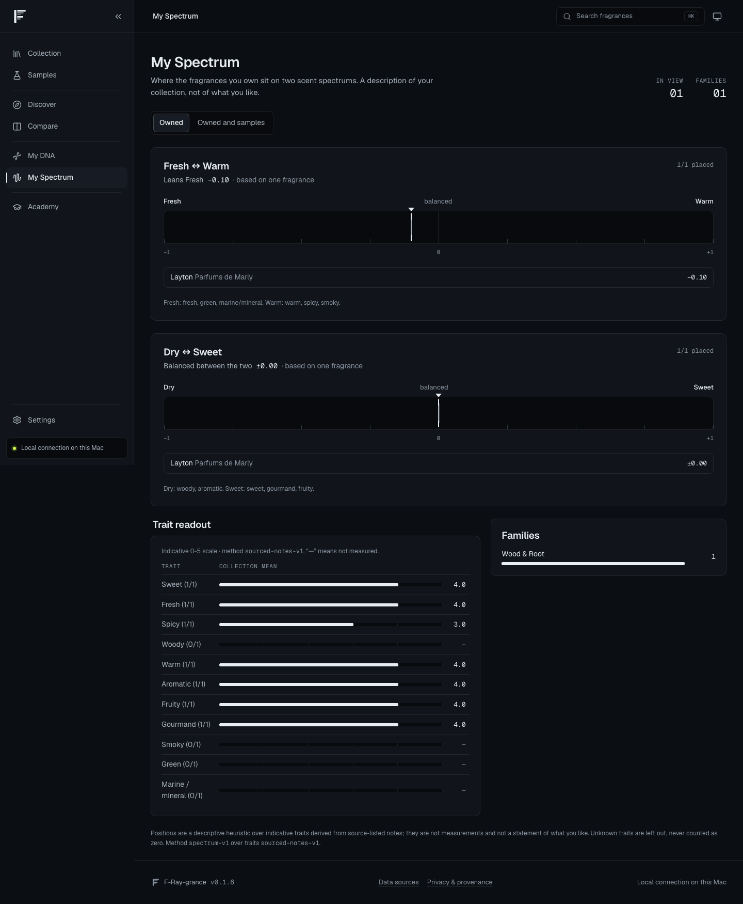
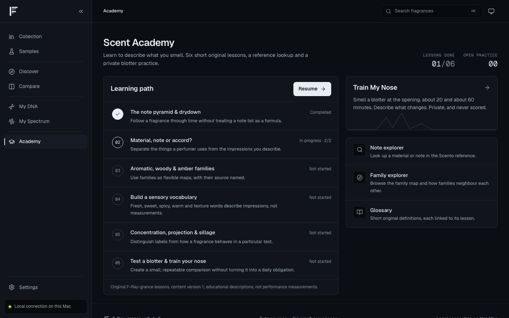
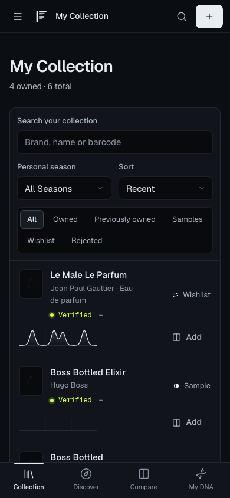

# I Built a Perfume App That Leaves the Gaps Visible

## F-Ray-grance: my private fragrance collection app for comparing perfumes, exploring scent notes and recording seasonal preferences

> A missing note pyramid stays missing. A similar name stays a suggestion. A trait that cannot be derived shows a dash, never a zero.

I own more perfume than I can describe. I know which bottle I reach for on a cold evening. I could not tell you why, or how that bottle relates to the rest of the shelf.

I wanted a way to look at my collection and understand it. Which fragrances share notes? Which ones differ? What do I enjoy in summer that I leave alone in winter? Keeping a list of bottles would only get me part of the way there.

So I built my own fragrance collection app. I called it F-Ray-grance. Its motto is *“Don't just track your fragrances. Understand your rotation.”*

It runs on my Mac. I can record what I own, compare perfumes, look up a bottle by its barcode and learn more about the notes in it. But names collide, sources disagree, and plenty of fragrances have incomplete profiles. I wanted those gaps to remain visible while I used the app.

> *All we know is that we don't know*
>
> *How it's gonna be*
>
> — Oasis, *The Masterplan* (1995)

*A demo collection. Three profiles are flat because the source supplied no note pyramid. The app draws that absence.*

## A fragrance collection that keeps more than the bottles I own

My perfume shelf only shows what is there now. It does not show the samples I tried, the bottle I finished or the fragrance I decided against.

F-Ray-grance keeps those distinctions. A fragrance can be:

- owned;
- previously owned;
- sampled;
- on my wishlist;
- rejected.

I can add a rating and a private note. When I change a fragrance's status, the app keeps its history. A bottle moving from owned to previously owned does not take my earlier record with it.

I wanted sampled and rejected fragrances in there too. Remembering what I have already tried is useful when I am looking at another bottle with a familiar name. A wishlist entry can sit alongside those records without being counted as something I own.

That collection is also the starting point for the rest of the app. I can open a fragrance's sourced profile, put two perfumes next to each other or see where the fragrances I own sit on a scent spectrum.

## Perfume barcode lookup without substituting a different fragrance

I can read the EAN off every bottle I own, and I wanted it to work the way an ISBN works for books. Quick find accepts a barcode, a fragrance name, part of a name or a brand.

A barcode lookup first checks identities I have already verified. If it needs a product-name hint, it tries Open Beauty Facts and then a web search. That hint becomes a search against Scento, the perfume data provider. When I confirm a fragrance, I can save the barcode with it for the next lookup.

The identity check is where I am deliberately strict. Dior Sauvage exists as an Eau de Toilette, an Eau de Parfum, a Parfum and an Elixir. They smell different. A search for “Sauvage” is not enough to decide which one belongs in my collection.

The app checks the brand, exact name and any known concentration. A nearby result stays a suggestion with a “Check this one” button. It does not become my bottle because it happened to appear first.

I ran into this with CK One Essence. The barcode on my own bottle returned the correct product name from Open Beauty Facts. Scento did not list it. The app offered CK One as a suggestion and left it there. That was the correct answer, even if it was not the one I wanted.

*The barcode supplies a product-name hint. None of the suggestions underneath is claimed to be that product.*

A verified identity can still have missing facts. I can know which fragrance I am looking at while its concentration or note pyramid remains unknown in the source.

## Reading perfume notes without pretending to measure the scent

I wanted a visual way to read a fragrance profile. F-Ray-grance draws the listed notes as a chromatogram, grouped into top, heart and base.

Each listed note gets one peak. The caption says what the shape means: “One peak per listed note. Height follows listed order, not concentration. Source: Scento.”

The peaks are a picture of a list. They do not measure the perfume's chemistry or tell me how strongly I will smell each note on my skin.

If the source has no pyramid, the chart stays flat. If it supplies an untiered list, that does not give me permission to assign the notes to top, heart and base myself.

*Phantom in Red's profile. Its verified identity and the availability of each fact are separate things.*

The same rule applies to scent traits. A documented method maps listed notes to eleven indicative traits. If no listed note supports a trait, it stays unknown and gets a dash. A zero would claim that the trait had been assessed and was absent.

Compare and My Spectrum use that same derivation, so the values agree across those views. The method version is visible beside them.

The visual design grew out of this. Graphite, white, monospaced labels and phosphor lime give the screens the feel of an instrument. The Spectral F logo has arms drawn as emission lines. I wanted to be able to read the data and its limits without opening a separate explanation every time.

## Filling missing fragrance details with sources I can review

Boss Bottled Elixir had an untiered note list in Scento, but no concentration or pyramid. I wanted a way to research those gaps while keeping the original source intact.

The Web research panel uses TinyFish to search and read at most two pages. It sends the public fragrance identity, not my collection, ratings or private notes. Before I start, the panel explains that the run may use TinyFish credits.

Each proposed fact comes with a source page and supporting quote. I accept or reject the proposals individually. Accepted values are labelled “Web research” and have the lowest precedence. They can fill a gap, but cannot replace my own entry or a higher-precedence source.

*The research panel at rest. I can see what is missing before deciding whether to look elsewhere.*

The page also has to concern the exact fragrance. “Sauvage Very Cool Spray” cannot supply facts for “Sauvage” merely because its title contains the name. A conflicting concentration or an unexplained extra qualifier causes rejection. The app shows the reason.

That can mean fewer results. I would rather read a rejected-page explanation than quietly save the facts for another perfume. If I choose to enter a fact myself, it remains identifiable as my own entry.

## Comparing two perfumes by their listed differences

Compare stays limited to two fragrances. I can put them side by side and start with “What differs?”

The view shows shared notes, notes listed only for each fragrance and comparable known trait scores. The source-backed profiles stay visible underneath.

*Phantom in Red against Layton. Known scores can be contrasted; unknown ones remain dashes.*

A sentence below the comparison says: “A note not listed on one side is not proof of its absence.” I wanted that printed beside the result. It is easy to read a missing item in a comparison as something the perfume does not contain, when all I know is that the source did not list it.

I can use the comparison to decide which differences I want to pay attention to when I smell the two. It cannot tell me which one I will enjoy more.

## Seasonal fragrance preferences that I choose myself

Owning a fragrance does not establish that I like it. It also does not establish that I want to wear it in every season.

My DNA lets me record my own choices for spring, summer, autumn and winter. For notes, families, accords and traits, I can choose Love, Neutral, Avoid or Unsure. Leaving something unrated is a separate state. I can also associate individual fragrances with a season and keep a private seasonal note.

I wanted “Unsure” to be a real answer. It gives me somewhere to leave an impression I have not settled on. Neutral records an opinion; unrated means I have not given one.

Those explicit choices provide seasonal context for discovery. I do not have to keep a daily wearing diary before the app becomes useful.

Discover can look for something similar to my stated preferences or something different that still fits them. It uses listed notes, families, positive ratings and seasonal choices, with reasons I can inspect. Optional local text embeddings add another way to compare public fragrance descriptions. That is text similarity, not a measurement of how two perfumes smell.

## My Spectrum shows where my collection sits

My Spectrum describes the fragrances in my collection on two axes, Fresh to Warm and Dry to Sweet. I can look at owned fragrances alone or include samples.

A fragrance is placed only when both ends of an axis have known supporting traits. The collection marker is the unweighted mean of the placed fragrances, with a band for their spread. Ratings do not affect it, and several bottles of one fragrance count once.

*One owned Layton on a demo account. One placed fragrance is labelled as one fragrance.*

Coverage is part of the result. If only two of six fragrances can be placed, I need to see that before interpreting the marker. A marker based on one fragrance says so. Ticks open the fragrance, and overlapping ticks open a short list I can use with a mouse, touch or keyboard.

This is a description of my collection. I might own several fresh fragrances because I bought them years ago, received them as gifts or tried something I no longer wear. My preferences belong in My DNA, where I choose them myself.

## Learning perfume notes with the Scent Academy

I built the Scent Academy because looking at a note pyramid does not mean I know what I am looking at.

It has six short, original lessons covering the note pyramid and drydown, materials and accords, families, descriptors, concentration, projection and sillage. A note explorer, family explorer and glossary give me somewhere to check a term without leaving the app. My lesson progress stays private.

Train My Nose is a blotter exercise. I smell at the opening, around twenty minutes and around sixty, and write down what changed. The timings are adjustable. There is no score.

*The Academy, with one lesson completed and one in progress on the demo account.*

The optional tutor needs a local generative model through Ollama. I have not configured that model, so the app says the tutor is unavailable. The lessons, reference material and blotter practice remain usable.

I can connect a practice to a fragrance I am exploring, then return to my own observations. The note list gives me something to look for; the practice gives me somewhere to record what I smelled.

## How HashiCorp Vault handles the app's credentials

I run a dedicated HashiCorp Vault instance for F-Ray-grance. It keeps the app's credentials separate from my other projects and gives me a way to issue, renew and revoke access to its database.

Vault issues PostgreSQL credentials with five-minute leases. Vault Agent authenticates through AppRole and writes those credentials to a file the API can read. When they change, the API replaces its database connection pool. I do not have to put a permanent database password in the application configuration.

The permissions are scoped too. The app's normal database login can read and write application data, but cannot create or drop tables or bypass the collection-history protections. Schema migrations use a separate, short-lived login that is revoked after the job.

Vault also stores the key used to protect login sessions and the TinyFish API key for web research and image search. Vault Agent supplies those to the API through files mounted read-only. The API itself holds no Vault token. My username and password still belong to the app's own sign-in; Vault handles the service credentials behind it.

I revoke the initial Vault root token after bootstrap. Vault's data persists separately from the application containers, and I unseal it after a restart. Running locally still leaves credentials to look after; this is how I manage them.

## Keeping my perfume collection private and under my control

F-Ray-grance runs locally on my Mac behind an owner login. There is no public sign-up. My ratings, notes, seasonal choices and practice observations belong to that account.

External lookups use the public fragrance identity. The app keeps source facts separate from my preferences and annotations. For a bottle image, I can upload my own photo and choose it as the primary image. If no image is available, the profile remains usable without one.

I can export my collection as a versioned JSON file, including its history, source claims, manual corrections and seasonal profiles. It excludes login credentials and sessions. Bulk import remains disabled while independent recovery is unverified; I add fragrances through the app.

I also need a way to remove data. Before removing a collection entry, I see what will go and what will stay, then confirm it. Linked practice notes can survive as generic blotter practice. The deletion log keeps counts and flags without retaining the text I asked to remove.

For a broader reset, `make purge` empties one owner's personal data while keeping the account and shared catalogue. `make clean-slate` also empties the shared catalogue and every owner's personal data, while keeping the accounts and the seeded lessons. Both require typed confirmation and a fresh backup before making changes.

Manual backups include the database and its referenced images. Local restore tests use a separate target. I have deferred an off-device copy and a restore on a second machine, so I have not proved recovery after losing the Mac.

## A mobile layout, with access still limited to my Mac

The layout adapts to a phone-sized screen. The sidebar becomes a drawer, the most-used destinations move to a bottom bar, and the note profile keeps its three tiers in the narrower frame.

*The collection at 390 pixels in a browser capture. The screenshots in this article use temporary demo accounts.*

Actual access from my iPhone is still deferred. Tailscale was blocked by my employer's DNS policy, and I chose to leave remote access out for now. I use the app on my Mac.

Somewhere in my cabinet there is a bottle of Boss Bottled Elixir. When Scento did not list its concentration, I added a way to research it and review the result. For CK One Essence, I had a barcode hint but no verified Scento identity. I left CK One in the suggestions.

## Give F-Ray-grance a try

If you want to explore your own fragrance collection this way, [give F-Ray-grance a try on GitHub](https://github.com/raymonepping/f_Ray_grance). The repository contains the code, specifications and operating instructions for running it locally on a Mac with Podman and its own Vault instance.

Start with the README and the linked operating runbook, then add a couple of bottles you know well. Check their exact identities, compare their listed notes and record your own seasonal preferences. If a bottle is missing or a result looks wrong, [open an issue on GitHub](https://github.com/raymonepping/f_Ray_grance/issues) with the fragrance name and what you found.
